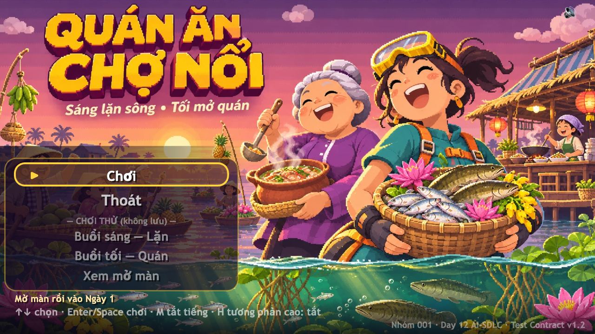
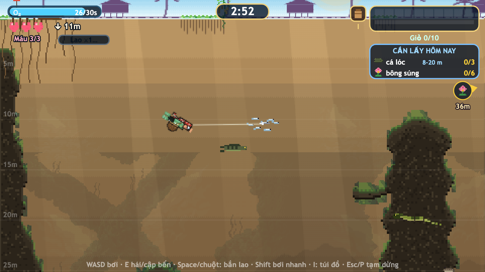
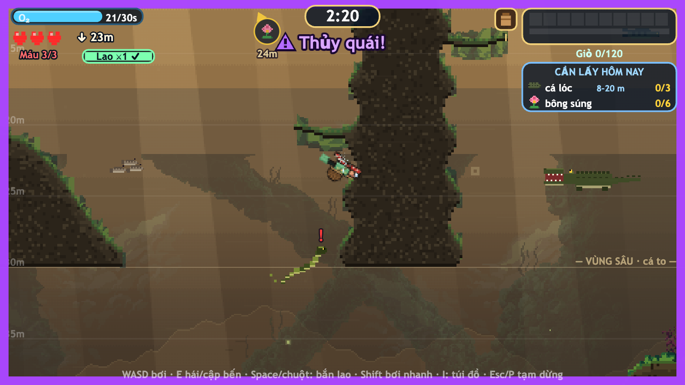
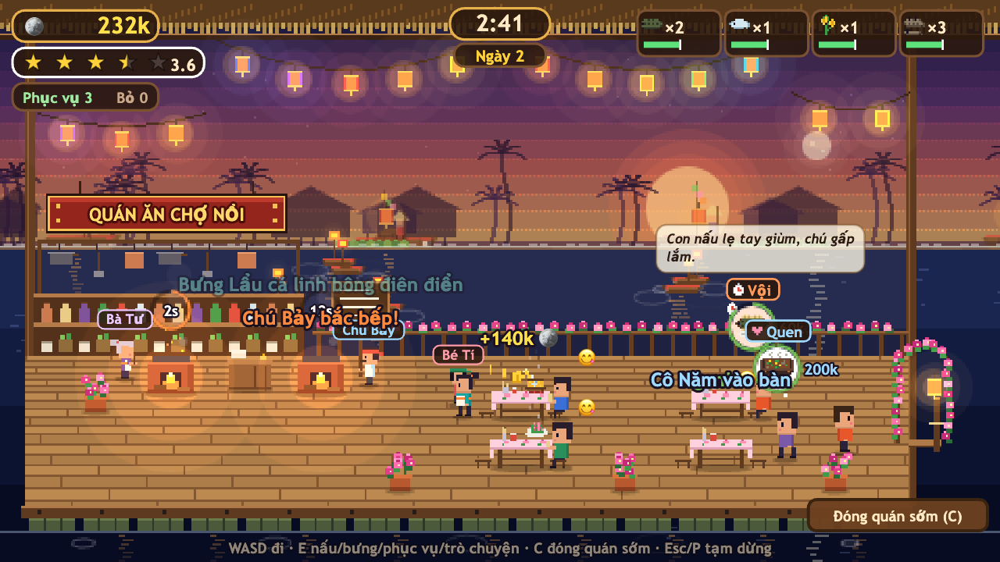
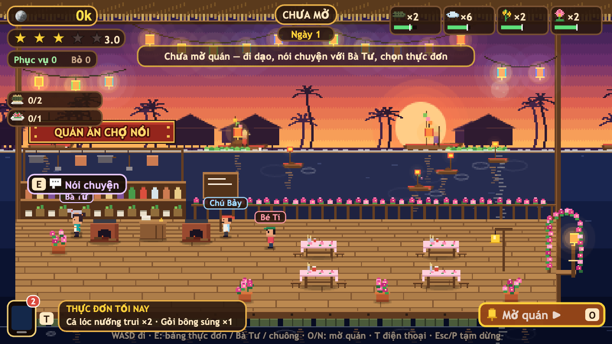
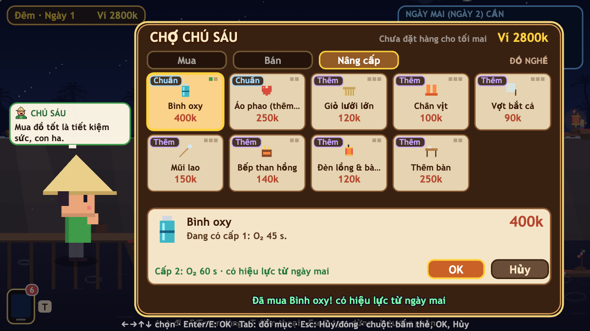
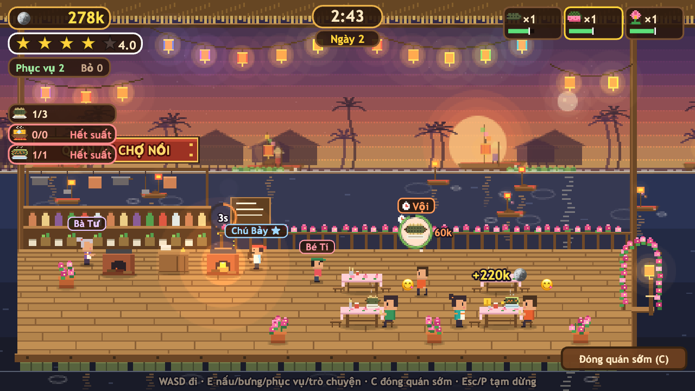

# Day 12 — AI SDLC: Quán Ăn Chợ Nổi

> **Làm theo nhóm 4–6 người** · Dùng AI để xây game 2D qua **4 phase** trong **3 giờ**: Út Sen lặn bắt cá, hái rau trên mặt nước rồi tối mở quán phục vụ khách.
> **Yêu cầu từng phase mở đúng mốc giờ tại lab board:** **[Chợ Nổi Lab](https://claude.ai/artifact/E35v787wSx2wDgPTNhMVDg)** (cần đăng nhập claude.ai; có trợ giảng AI cho từng phase).

## Nhóm Nhom001 — Release v1.0.0 (Phase 4, Test Contract v1.3)

**Quán Ăn Chợ Nổi** — Út Sen lặn bắt cá bằng lao móc, hái rau trên sông, tối mở quán trên nhà bè; 5 Ngày theo kế hoạch của Má Tư.
Bản tải về: GitHub Release **v1.0.0** → `quan-an-cho-noi-v1.0.0.zip` (giải nén, chạy `./run.sh`; macOS có thể bấm đúp `run.command`).
Ghi chú phát hành: [`docs/release/RELEASE_NOTES_v1.0.0.md`](docs/release/RELEASE_NOTES_v1.0.0.md) · thay đổi: [`CHANGELOG.md`](CHANGELOG.md).

### Video demo (1:55, 2 Ngày chơi)

[](docs/media/demo.mp4)

▶ **[Xem video demo — `docs/media/demo.mp4`](docs/media/demo.mp4)** (1280×720, không tiếng; bấm ảnh hoặc link để mở trình phát của GitHub).
Ngày 1: lặn bắt cá → thuê Bé Tí, Chú Bảy và trang trí quán với Bà Tư → mở quán, nhân viên phục vụ → kết sổ → mua nâng cấp ở chợ đêm Chú Sáu. Ngày 2: lặn sâu hơn với bình oxy mới, hạ Cá Sấu Năm Chèo → món đặc sản được phục vụ.

| Lặn & lao móc | Cá Sấu Năm Chèo | Quán nhà bè đông khách |
|---|---|---|
|  |  |  |
| **Thuê người & trang trí** | **Chợ Chú Sáu — nâng cấp** | **Món đặc sản** |
|  |  |  |

Toàn bộ 24 ảnh và cách quay lại: [`docs/media/README.md`](docs/media/README.md).

### Yêu cầu môi trường
- macOS hoặc Linux, **Python ≥ 3.9** (chỉ thư viện chuẩn, không `pip install`), `git`.
- Trình duyệt hiện đại có ES modules + WebAudio (Chrome/Edge/Firefox/Safari bản gần đây). Màn hình ≥ 1280×720, có bàn phím.
- Mở qua HTTP (không mở `file://` vì trình duyệt chặn ES modules). Cổng mặc định 8099.
- Benchmark (`tools/bench.py`) cần Chrome hoặc Chromium cài sẵn. Đóng gói Release cần thêm lệnh `zip`.

### Chạy bản GUI từ clone sạch (3 lệnh)

```bash
git clone https://github.com/workcaominh-gif/K5-L3B-LAB-Day12-AI-SDLC-Nhom001.git
cd K5-L3B-LAB-Day12-AI-SDLC-Nhom001
python3 -m http.server 8099 --bind 127.0.0.1
```

Rồi mở **http://127.0.0.1:8099/client/index.html** (Ctrl+C trong terminal để dừng).

### Điều khiển (bản GUI)

| Phím | Tác dụng |
|---|---|
| WASD / mũi tên | Bơi (lặn) hoặc đi (bến, nhà bè, chợ) |
| Shift | Bơi nhanh (tốn oxy hơn) |
| Space / chuột trái | Bắn lao móc |
| E | Tương tác: cập bến, hái rau, nấu/bưng/phục vụ, nói chuyện, mua bán |
| Enter / chuột | Chọn trong menu |
| N · Tab | Mở quán từ bảng thực đơn · đổi tab trong Shop |
| I | Túi đồ (X vứt, Shift+E vứt cả loại) |
| T | Điện thoại (tin nhắn, việc vặt của Bà Tư, thuê người, trang trí) |
| C | Đóng quán sớm |
| Esc / P | Tạm dừng / cài đặt |
| M | Tắt/bật tiếng |
| H | Chế độ tương phản cao (lưu lại giữa các lần chơi) |
| U | Phụ đề âm thanh (lưu lại; tự bật khi tắt tiếng bằng M) |

Màn hình gợi ý phím luôn hiện ở đáy HUD. Video mở đầu: lần bấm đầu bật tiếng, sau đó phím/chuột bất kỳ hoặc nút "Bỏ qua" để vào màn hình tiêu đề.

### Test, headless, benchmark, soak

```bash
PYTHONPATH=tests:. python3 -m unittest discover -s tests                         # toàn bộ test tự động
python3 -m chonoi.headless --mode day --days 5 --seed 7 --ticks 120000 --out week.jsonl   # trọn D1–D5 headless
python3 tools/bench.py --seed 42 --duration 30 --out bench.json                   # bench_cmd: FPS bản GUI qua Chrome/Chromium headless
python3 tools/soak.py --seed 7 --days 10 --out soak.json                           # soak_cmd: 10 Ngày liên tiếp, đạt khi crashes == 0
bash tools/package.sh                                                              # tạo dist/quan-an-cho-noi-v1.0.0.zip
```

Lệnh chuẩn đọc từ `game.contract.json`: `headless_cmd`, `bench_cmd`, `soak_cmd`. Cửa sổ khung của starter vẫn chạy được: `python3 -m chonoi.live --mode gather`.

### Mở rộng Phase 4 (TICKET-04 mục 3)

**Bảng xếp hạng cục bộ.** Top 10 bền vững, sắp điểm giảm dần, hòa điểm thì mục ghi trước đứng trước.

```bash
# ghi đúng một mục khi lượt day chuẩn đủ 5 Ngày (không --scenario, reason "days_complete")
python3 -m chonoi.headless --mode day --days 5 --seed 7 --ticks 120000 --out week.jsonl --leaderboard lb.json --player-name "Út Sen"
# <run_cmd> --export-leaderboard: xuất {"entries":[{"name","score","days_completed","seed"}]}
python3 -m chonoi.live --mode gather --export-leaderboard top.json --leaderboard lb.json
```

- Thiếu một trong hai cờ `--leaderboard` / `--player-name`, hoặc dùng với `gather`/`quan` → mã 2, không ghi đầu ra. Store hỏng hoặc tên rỗng → mã 2.
- Thiếu `--leaderboard` khi export → đọc `leaderboard.json` ở gốc repo (đã gitignore); store chưa có → `{"entries":[]}`.
- JSONL không đổi khi có cờ xếp hạng. Soak (`tools/soak.py`) không ghi xếp hạng.
- Bản GUI: sau "Tổng kết mùa nước nổi" người chơi gõ tên và thấy top 10 (lưu trong trình duyệt, cùng luật xếp hạng). Lượt demo không ghi.

**Phụ đề SFX.** Bấm **U** (hoặc mục "Phụ đề âm thanh" trong menu tạm dừng). Phụ đề tự bật khi tắt tiếng bằng **M**.
Các âm thanh mang thông tin đều có chữ: *[Cá Sấu gầm — đang đến gần]*, *[Cá Sấu cắn]*, *[tim đập nhanh — oxy sắp hết]*, *[ngạt nước]*,
*[chuông — khách mới tới]*, *[khách T1 càu nhàu — sắp giận]*, *[khách giận dỗi bỏ đi]*, *[tiếng tiền rơi]*… Tiếng click menu không có phụ đề.
Ở chế độ tương phản cao phụ đề có nền đen, viền trắng, chữ vàng.

Bằng chứng: `tests/test_leaderboard_p4.py` (17 test), [`docs/proof/phase-4/ext/`](docs/proof/phase-4/ext/) (log CLI, ảnh chụp, script `ui_check.mjs`), ma trận ở [`docs/verification/phase-4.md`](docs/verification/phase-4.md).

### Sáng tạo của nhóm
Bản GUI `client/` (không bắt buộc, tắt hoàn toàn ở headless): video mở đầu, nhà bè ban đêm với bảng thực đơn và nhân viên, Bà Tư và việc vặt, điện thoại, Chợ Chú Sáu, săn cá có máu, Cá Sấu và boss Cá Tra Dầu, địa hình đáy sông + dòng nước, nhạc tổng hợp bằng WebAudio, chế độ tương phản cao.
Asset và giấy phép: [`CREDITS.md`](CREDITS.md) · mã nguồn: [`LICENSE`](LICENSE) (MIT, asset giữ giấy phép riêng).

## Nhóm Nhom001 — Phase 2 (Test Contract v1.1)

**Một vòng Ngày headless** (gather → quán → Shop; mỗi Ngày tối đa 22.200 tick, ~1 s):

```bash
python3 -m chonoi.headless --mode day --days 1 --seed 7 --ticks 30000 --out day.jsonl            # 1 Ngày (mặc định --days 1)
python3 -m chonoi.headless --mode day --days 5 --seed 7 --ticks 120000 --out week.jsonl          # trọn D1–D5
python3 -m chonoi.headless --mode day --days 2 --seed 7 --ticks 50000 --out multi.jsonl \
  --scenario docs/proof/phase-2/multiday-scenario.json --inputs docs/proof/phase-2/multiday-inputs.json  # mua nâng cấp Ngày 1
bash docs/proof/phase-2/run_proof.sh                                                             # tái tạo toàn bộ bằng chứng P2
```

- `--days N` chỉ với `day`, 1..5. Kho bàn giao gather → quán **trong bộ nhớ** (schema kho đếm); hai cờ `--inventory`/`--inventory-out` vẫn dành cho hai mode độc lập.
- Scenario `day`: `{"day":{"money","earned","reputation","upgrades","day_plan"}, "gather":{…}, "quan":{…}}`; `gather`/`quan` là mẫu dựng mỗi Ngày; cấm `quan.stock`, `quan.reputation` (dùng `gather.hold`). Cần `0 ≤ money ≤ earned`.
- Đầu Ngày Má Tư công bố kế hoạch (`day_plan` D1–D5 trong `game.contract.json`); tối khách chỉ gọi món trong kế hoạch còn đủ nguyên liệu. Quán chạy riêng dùng cả 6 món.
- Shop cuối Ngày: `buy: "oxygen"` (200 → 45 s, 400 → 60 s), `buy: "hp"` (250 → 4 Máu, 500 → 5 Máu), trừ `money`, giữ `earned`/điểm; cấp vừa mua có hiệu lực từ **Ngày kế**. Đóng bằng `shop_done` hoặc tự đóng sau 600 tick.

**Điều khiển (v1.1):** WASD / mũi tên bơi hoặc đi · **E** `interact` · **Space** `catch` · **Esc / P** `pause` (dừng đồng hồ và mọi timer gameplay, cả trong Shop; bấm lần nữa để tiếp tục) ·
trong Shop: `buy` = `"oxygen"` / `"hp"`, `shop_done` để đóng Shop. File inputs: nút boolean chỉ tác động ở cạnh lên, `buy` là chuỗi chỉ có hiệu lực tại frame khai báo.
(Trong cửa sổ `chonoi.live` hiện chưa có mode `day` và chưa map Esc/P — xem phần "chưa đạt" ở ma trận.)

**Điểm:** `earned + 100 × floor(reputation)`. `earned` = tiền món + boa cộng dồn qua mọi Ngày; mua nâng cấp chỉ trừ `money`, không làm giảm `earned` hay điểm.
Tiền, earned, uy tín và cấp nâng cấp giữ qua Ngày; oxy/Máu hồi đầy theo cấp đang áp dụng; giỏ làm mới, kho dư bị bỏ sau Shop.

**Bằng chứng Phase 2:** [`docs/verification/phase-2.md`](docs/verification/phase-2.md) · kế hoạch [`docs/plan/phase-2.md`](docs/plan/phase-2.md) · giả định [`docs/clarify.md`](docs/clarify.md).

## Nhóm Nhom001 — Phase 1

**Chạy từ clone sạch (macOS/Linux, Python ≥ 3.9, không cần cài thêm gì):**

```bash
git clone <fork-của-nhóm> && cd <fork-của-nhóm>
PYTHONPATH=tests:. python3 -m unittest discover -s tests -v   # toàn bộ test (1 lệnh)
python3 -m chonoi.live --mode gather                           # chơi thử trên trình duyệt (đổi --mode quan cho buổi tối)
```

Nối hai buổi qua file kho (hai tiến trình headless):

```bash
python3 -m chonoi.headless --mode gather --seed 1 --ticks 10800 --out gather.jsonl --inventory-out kho.json --inputs <inputs.json>
python3 -m chonoi.headless --mode quan --seed 1 --ticks 10800 --out quan.jsonl --inventory kho.json --inputs <inputs.json>
```

**Điều khiển:** WASD / mũi tên bơi hoặc đi · **E** (`interact`): cập bến, hái bông ở mặt nước, nấu / bưng / phục vụ ·
**Space** (`catch`): bắt đàn cá khi đang lặn · **R** chơi lại (cửa sổ `chonoi.live`).

**Điểm:** `earned + 100 × floor(reputation)` (ở mọi snapshot và dòng `end`). `earned` là tiền món + boa thu được;
boa = `floor(giá × 0.2)` khi khách còn ≥ 50% kiên nhẫn, mỗi lần boa +0.2 uy tín; khách bỏ đi −0.5 uy tín; uy tín kẹp [0, 5].

**Bằng chứng Phase 1:** [`docs/verification/phase-1.md`](docs/verification/phase-1.md) · tái tạo: `bash docs/proof/phase-1/run_proof.sh`.

### Hợp đồng kho (Lặn & Hái → Mở Quán)

Schema (Test Contract mục G):

```json
{"type":"object","additionalProperties":false,"required":["items"],
 "properties":{"items":{"type":"object","additionalProperties":false,
   "properties":{"ca_loc":{"type":"integer","minimum":0},"ca_linh":{"type":"integer","minimum":0},
                 "bong_dien_dien":{"type":"integer","minimum":0},"bong_sung":{"type":"integer","minimum":0}}}}}
```

Ví dụ hợp lệ ([`docs/contracts/inventory.sample.json`](docs/contracts/inventory.sample.json)): `{"items":{"bong_sung":2,"ca_loc":1}}` · kho rỗng: `{"items":{}}`.

- `gather --inventory-out` ghi **một lần** khi có `gather_end` và khớp `inventory` trong event đó (ngất → kho rỗng);
  chạm `--ticks` trước khi xong thì không ghi. Ghi file tạm rồi thay thế nguyên tử, bỏ khóa có lượng 0, sắp theo id.
- `quan --inventory` từ chối sai schema / kind lạ / số âm (mã 2). Trần giỏ không áp lên kho quán.

## Bắt buộc (chỉ có thế)

Cách làm việc kỹ thuật là **tự do** (push thẳng, nhánh + PR, pair, có hay không CI…). Cái bắt buộc:

1. **Một repo chung:** trưởng nhóm **fork** repo này, đặt tên `K5-L3B-LAB-Day12-AI-SDLC-<ten-nhom>`, thêm mọi thành viên làm collaborator (*Settings → Collaborators*, quyền Write) và để repo **public** (giảng viên xem được, không cần mời).
2. **Cả nhóm cùng commit** bằng tài khoản GitHub của mình, mỗi người **≥ 3 commit có nội dung** (làm cặp thì ghi `Co-authored-by:`).
3. **Điền [`TEAM.md`](TEAM.md):** danh sách thành viên + thỏa thuận làm việc nhóm; sửa `team_size` trong [`game.contract.json`](game.contract.json). Commit của người không có trong `TEAM.md` không được tính.
4. **Gắn tag** `phase-1` … `phase-4` đúng hạn; chạy được tại từng tag.
5. **Ghi chép tối thiểu:** `docs/verification/phase-n.md`, `docs/clarify.md`, `docs/ai-usage-log.md`, `docs/retro.md`, `docs/members/<handle>.md`.

## Bắt đầu nhanh

```bash
git clone <fork-của-nhóm> && cd <fork-của-nhóm>
PYTHONPATH=tests:. python3 -m unittest discover -s tests -v        # smoke test
python3 -m chonoi.live --mode gather                                # chơi thử trên trình duyệt (tùy chọn)
```

Game cần chế độ **headless** theo Test Contract (`python3 -m chonoi.headless --mode gather|quan …`) để được chạy và chấm tự động. **Công nghệ không ràng buộc**: khung Python trong `chonoi/` chỉ là gợi ý, chi tiết ở [`docs/STARTER.md`](docs/STARTER.md).

## Tự do sáng tạo

Ngoài phần đề yêu cầu, nhóm được **thêm** nhân vật, loài cá/cây, sinh vật, món, bản đồ, cơ chế, câu chuyện, đồ họa, âm nhạc… với ba điều kiện: **không phá phần cố định** (tắt ở headless), ghi mục **"Sáng tạo của nhóm"** trong README của nhóm, và **làm lõi đúng trước**.

## Lịch 3 giờ

| Mốc | Phase | Hạn tag |
|---|---|---|
| 0:00 | Phase 1 (PRD-0) | `phase-1` trước 1:00 |
| 1:00 | Phase 2 | `phase-2` trước 1:55 |
| 1:55 | Phase 3 | `phase-3` trước 2:30 |
| 2:30 | Phase 4 | `phase-4` + Release `v1.0.0` trước 3:00 |

Hết giờ mỗi phase thì gắn tag rồi đi tiếp; chỗ chưa xong ghi trung thực trong bằng chứng.

## Đánh giá (100 điểm)

| Hạng mục | Điểm |
|---|---|
| Test tự động ẩn (headless, gồm kiểm tra lại phase trước) | 25 |
| Làm việc nhóm (một repo chung, chia việc, tích hợp, đổi yêu cầu) | 25 |
| Kiểm chứng & bằng chứng | 15 |
| Harness AI (AGENTS.md, skill, nhật ký dùng AI) | 10 |
| Đánh giá & retro | 10 |
| Chất lượng sản phẩm (đúng yêu cầu, mở rộng/sáng tạo) | 10 |
| Demo | 5 |

## Quy định

- Dùng AI thoải mái; **không sao chép repo của nhóm khác**; bằng chứng phải thật.
- Nhân vật, bối cảnh là bản gốc của lab; asset ngoài chỉ dùng CC0/CC-BY/MIT hoặc tự tạo, ghi nguồn trong `CREDITS.md`. Không commit API key, token, `.env`.

## Phase 3 — Độ tươi (Test Contract v1.2)
- Kho cá thể `{"items":[{"id","kind","fresh"}]}`; giỏ hao 0.5/s, kho quán 0.25/s (kể cả hàng giữ), ươn khi fresh < 30 (event `spoiled`).
- Giữ chỗ theo id (tươi nhất, hòa theo id), giữ lại một lần khi phần giữ vừa ươn; giá chốt `floor(giá × mean fresh / 100)`.
- Bằng chứng: `bash docs/proof/phase-3/run_proof.sh`; truy vết `docs/verification/phase-3.md`; kế hoạch/tác động `docs/plan/phase-3.md`; thay đổi `CHANGELOG.md`.
