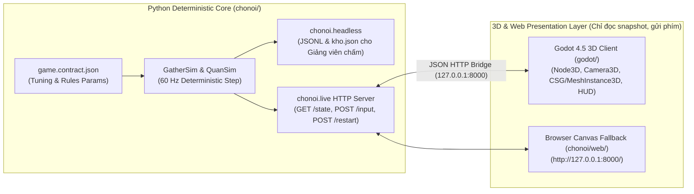

# Hợp đồng tích hợp (Integration Contract — Nhóm AnhChang3Chan)

> Chốt trong giai đoạn Kickoff Phase 1. Mọi thành viên làm Lát 1–4 (`chonoi/sim/*`), Client Godot 3D (`godot/`) và QA (`tests/`) đều tuân thủ hợp đồng này. Khi cần thay đổi phải báo Integrator (`hoangvu1806`) và PO/QA (`double-n-021`).

---

## 1. Kiến trúc Tách biệt Core Simulation (Python) & 3D Presentation (Godot 4.5)



- **Quy tắc số 1 (Bảo vệ 25 điểm Test tự động ẩn):** Giữ nguyên `"headless_cmd": "python3 -m chonoi.headless"` trong `game.contract.json`. Tuyệt đối không nhân đôi luật chơi sang GDScript.
- **Quy tắc số 2 (Godot 3D Bridge):** Godot 3D (`godot/main.tscn`, `godot/main.gd`) kết nối với `python3 -m chonoi.live --mode gather|quan --port 8000` qua HTTP (`GET /state`, `POST /input`, `POST /restart`) hoặc chạy chế độ 3D Preview độc lập khi server chưa bật.
  - Trong chế độ `gather` (vị trí 2D trong sim là `[x, d]` với `x in [0, 100]`, độ sâu `d in [0, 30]`): Ánh xạ sang không gian 3D Godot là `Vector3(x, -d, 0)` (camera 3D nhìn ngang/nghiêng xuống dòng sông 3D, mặt nước tại `y = 0`).
  - Trong chế độ `quan` (vị trí 2D trong sim là `[x, z]` với `x in [0, 16]`, `z in [0, 10]`): Ánh xạ sang không gian 3D Godot là `Vector3(x, 0, -z)` (camera 3D góc nhìn thứ ba / top-down nghiêng xuống sàn quán ăn nổi 3D).

---

## 2. Schema File Kho (`inventory`) — Giao diện giữa Buổi Sáng (`gather`) và Buổi Tối (`quan`)

- **Thời điểm ghi:** Chỉ ghi **đúng 1 lần** khi buổi `gather` kết thúc (`gather_end` với `reason` thuộc `{"docked", "time", "fainted"}`). Nếu dừng vì hết `--ticks` (`reason == "tick_limit"`), **không** ghi file kho. Nếu `reason == "fainted"`, giỏ bị mất hết nên ghi `{"items": {}}`.
- **Định dạng JSON (`docs/contracts/inventory.sample.json`):**
  ```json
  {"items":{"bong_sung":2,"ca_loc":1}}
  ```
- **Ràng buộc:**
  - Khóa gốc duy nhất: `"items"` (object ánh xạ `kind -> số nguyên dương > 0`).
  - Các `kind` hợp lệ ở Phase 1 (`KINDS_P1`): `"bong_dien_dien"`, `"bong_sung"`, `"ca_linh"`, `"ca_loc"`.
  - Nguyên liệu có số lượng `0` không được xuất hiện trong `"items"` (hoặc khi nạp vào `quan.stock` chỉ giữ khóa có giá trị `> 0`).

---

## 3. Giao diện giữa `sim/*` và `client/ui` (Godot 3D & Web)

### 3.1. Lệnh từ Client gửi vào Sim (`POST /input`)
```json
{
  "move": [0.0, 0.0],
  "interact": false,
  "catch": false
}
```
- `move`: `[mx, md]` trong `gather` (`md > 0` là bơi xuống sâu) hoặc `[mx, mz]` trong `quan` (`mz > 0` là đi lên hướng bắc). Mỗi thành phần thuộc `[-1, 1]`; server tự chuẩn hóa vector có độ dài `<= 1`.
- `interact` (phím `E`): phát hiện cạnh lên (`false -> true`) để cập bến / hái nút (ở `gather`) hoặc tương tác bếp / bàn (ở `quan`).
- `catch` (phím `Space`): phát hiện cạnh lên (`false -> true`) để bắt đàn cá khi ở dưới nước (`gather`).

### 3.2. Trạng thái Sim trả về cho Client (`GET /state` & dòng `snapshot` trong JSONL)
- **Các trường chung mọi mode:**
  `type` (`"snapshot"`), `tick`, `sim_tick`, `mode`, `phase`, `phase_tick`, `state` (`"playing"` | `"finished"`), `time_left_ticks`, `money`, `earned`, `reputation`, `score`.
- **Khối `gather`:**
  - `player`: `{"pos": [x, d], "vel": [vx, vd], "heading_deg": float, "oxygen_ticks": int, "oxygen_max_ticks": int, "hp": int, "hp_max": int, "zero_oxy_ticks": int, "invuln_ticks": int, "catch_cd_ticks": int, "at_surface": bool}`
  - `hold`: danh sách nguyên liệu theo thứ tự nhặt (LIFO, cuối mảng là mới nhất), `hold_count`, `hold_capacity`.
  - `nodes`: `[{"id": "N1", "pos": [x, 0], "kind": str, "ready": bool, "regrow_ticks": int}, ...]` (đã sắp theo `sort_by_id`).
  - `fish`: `[{"id": "F1", "pos": [x, d], "kind": str, "heading_deg": float}, ...]` (đã sắp theo `sort_by_id`).
- **Khối `quan`:**
  - `player`: `{"pos": [x, z]}` (và `"vel"` nếu cần nội suy).
  - `stock`: `{"ca_loc": 1, ...}` (chỉ gồm các khóa có số lượng `> 0`, sắp theo bảng chữ cái).
  - `hand`: `null` hoặc thông tin món đang bưng trên tay.
  - `stoves`: `[{"id": "B1", "pos": [x, z], "state": "idle"|"cooking"|"ready", "dish": str|null, "cook_ticks_left": int, "ready_ticks": int}, ...]`
  - `tables`: `[{"id": "T1", "pos": [x, z], "customer_id": str|null}, ...]`
  - `customers`: danh sách khách đang ngồi bàn (đã sắp theo `sort_by_id`).

---

## 4. Danh sách Sự kiện (`type: "event"`) theo Thứ tự Xử lý trong 1 Tick

### 4.1. Chế độ `gather` (Buổi sáng — Lát 1 & Lát 2)
Thứ tự trong `GatherSim.step(inp)`:
1. `node_regrown`: khi `regrow_ticks` giảm về `0` (`data: {"node_id": n["id"]}`).
2. `dive` / `surface`: sau khi `_move(inp)`, nếu vượt qua ngưỡng `surface_depth` (`0.5m`).
3. `oxygen_empty`: khi `oxygen_ticks` dưới nước vừa giảm từ `> 0` xuống `0`.
4. `choke`: khi `oxygen_ticks == 0` dưới nước và `zero_oxy_ticks` chạm `choke_interval_ticks` (`60`), trừ `1` Máu.
5. `faint` + `gather_end` (`reason: "fainted"`): ngay khi `hp` về `0`, xóa giỏ `hold = []`, kết thúc ca ngay trong tick đó.
6. `gather_end` (`reason: "docked"`): khi bấm `interact` trong bán kính bến `dock_radius` (`3.0m` quanh `[2, 0]`). **Xét cập bến TRƯỚC hái nút.**
7. `gather` / `hold_full`: khi bấm `interact` ở mặt nước (`d <= surface_depth`), xét nút `ready` gần nhất trong `interact_radius` (`2.0m`, ưu tiên `id` nhỏ khi bằng khoảng cách).
8. `fish_caught` / `hold_full`: khi bấm `catch` ở dưới nước (`d > surface_depth`) và `catch_cd_ticks == 0`, xét đàn cá gần nhất trong `catch_radius` (`2.0m`, ưu tiên `id` nhỏ).
9. `gather_end` (`reason: "time"`): khi `time_left_ticks` về `0` ở cuối bước.

### 4.2. Chế độ `quan` (Buổi tối — Lát 3 & Lát 4)
Thứ tự trong `QuanSim.step(inp)` (chi tiết trường `data` đối chiếu mục E & F của PRD-0):
1. Giảm bộ đếm bếp nấu (`dish_ready` khi `cook_ticks_left` về `0`), khách ăn (`paid` khi `eat_ticks_left` về `0`, cộng tiền + tip + uy tín), khách chờ (`customer_left` khi `patience_ticks_left` về `0`, trừ `left_reputation_delta`).
2. Di chuyển `_move(inp)`.
3. Xử lý tối đa **1** `interact` trong `interact_radius` (`1.5m`), ưu tiên `(khoảng cách nhỏ nhất, bếp trước bàn, id nhỏ nhất)`: `cook_started`, `dish_picked`, `served`.
4. Khách mới đến theo lịch (`first_customer_tick = 120`, sau đó mỗi `customer_interval_s = 15s` = `900 ticks`): chọn món nấu được và giữ chỗ nguyên liệu (`reserved`), hoặc phát `no_dish`.
5. Kết thúc ca `quan_end` (`reason: "time"`) khi `time_left_ticks` về `0`.
