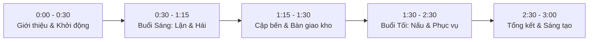

# Kịch Bản Demo 3 Phút — Quán Ăn Chợ Nổi (Team MMMMV)
> **Phụ trách:** Tào Quang Vinh (`@qvinhh2312` — UX + Demo lead)  
> **Thời lượng:** 3 phút (180 giây)  
> **Mục tiêu:** Trình diễn trọn vẹn vòng lặp gameplay 1 ngày của Út Sen: Buổi sáng thu hoạch trên sông Chín Khúc $\rightarrow$ Bàn giao kho $\rightarrow$ Buổi tối phục vụ thực khách tại nhà bè Má Tư (bao gồm cả cơ chế độ tươi và âm thanh tự sinh).

---

## Phân bổ thời gian (180s)

---

## 1. Mở đầu: Bối cảnh & Giới thiệu (0:00 – 0:30)
- **Lời thoại:**
  > "Kính chào thầy và các bạn! Nhóm MMMMV xin giới thiệu dự án *Quán Ăn Chợ Nổi*. Người chơi sẽ hóa thân thành cô bé Út Sen tại chợ nổi miền Tây. Game gồm hai buổi độc lập kết nối qua tệp kho nguyên liệu: Buổi sáng lặn ngụp thu hái trên sông, buổi tối đỏ lửa phục vụ khách tại nhà bè. Điểm đặc biệt của nhóm là toàn bộ âm thanh và đồ họa đều tự sinh bằng code, 0 KB asset ngoài và tuân thủ 100% tính tất định headless."
- **Thao tác màn hình:**
  - Khởi chạy: `python3 -m chonoi.live --mode gather`.
  - Giới thiệu thanh HUD: Đồng hồ ⏱, thanh Oxy xanh biển, Máu ♥♥♥ và các ô giỏ hàng.
  - Bấm phím `M` bật âm thanh, nghe tiếng nước chào đón.

## 2. Buổi Sáng: Lặn bắt cá, Hái rau & Độ tươi (0:30 – 1:15)
- **Lời thoại:**
  > "Vào buổi sáng, Út Sen bơi trên mặt nước để hái bông điên điển bằng phím [E] khi thấy prompt màu xanh hiện lên. Tiếp theo, em lặn xuống sông Chín Khúc, hiệu ứng bọt khí nổi lên và thanh oxy bắt đầu giảm dần. Em áp sát đàn cá linh, nhấn [Space] bắt cá — tiếng quẫy nước vang lên! Đặc biệt theo cơ chế Mùa Nước Nổi, mỗi con cá bắt lên đều có thanh độ tươi riêng; nếu để quá lâu dưới 30, cá sẽ bị ươn và hiển thị gạch chéo đỏ kèm âm thanh cảnh báo!"
- **Thao tác màn hình:**
  - Di chuyển hái bông điên điển `[E]`, nghe tiếng chuông thu hoạch trong trẻo.
  - Lặn xuống nước, bọt khí sủi tăm, áp sát cá linh nhấn `[Space]`.
  - Chỉ vào thanh độ tươi mini dưới đáy ô giỏ hàng.
  - Cho thấy thanh Oxy chuyển từ Xanh $\rightarrow$ Cam $\rightarrow$ Đỏ cảnh báo khi xuống sâu.

## 3. Cập bến & Chuyển giao kho (1:15 – 1:30)
- **Lời thoại:**
  > "Khi giỏ hàng đầy hoặc oxy cạn, Út Sen bơi về bến tàu. Banner `[E] Cập bến & Chốt kho` hiện lên. Nhấn [E], ca sáng kết thúc thành công với lý do `docked`. Toàn bộ sản vật còn tươi ngon được lưu an toàn vào tệp kho `inventory.json`."
- **Thao tác màn hình:**
  - Bơi về bến tàu [2, 0], nhấn `[E]`, nghe tiếng chuông cập bến keng keng.
  - Màn hình kết thúc hiện: `BUỔI SÁNG KẾT THÚC: CẬP BẾN AN TOÀN` kèm thống kê sản lượng.
  - Mở terminal cho thấy `inventory.json` đã lưu các cá thể kèm độ tươi.

## 4. Buổi Tối: Nhà bè đỏ lửa phục vụ khách (1:30 – 2:30)
- **Lời thoại:**
  > "Bước sang buổi tối tại nhà bè Má Tư. Khách vào bàn gọi món lẩu cá linh bông điên điển hoặc cá lóc nướng trui. Thanh kiên nhẫn của khách đếm ngược. Út Sen tới bếp nhấn [E] để nấu, làn khói bếp bốc lên; khi bếp chín báo `Ready`, em bưng món trên tay và mang ra bàn phục vụ đúng đơn để thu tiền và nhận tiền boa uy tín!"
- **Thao tác màn hình:**
  - Khởi chạy: `python3 -m chonoi.live --mode quan`.
  - Khách vào bàn, Út Sen tới bếp nhấn `[E]` nấu món (khói bếp bốc lên).
  - Bếp chuyển sang `Ready`, nhấn `[E]` bưng món (HUD hiện món trên tay 🍲).
  - Mang lại bàn phục vụ, khách ăn, tiền 💰 và uy tín ⭐ tăng lên cùng tiếng tiền leng keng vui tai.
  - Chỉ vào kho dự trữ: Các nguyên liệu ươn bị lọc riêng và không thể đem nấu.

## 5. Kết thúc & Điểm nhấn sáng tạo (2:30 – 3:00)
- **Lời thoại:**
  > "Khi hết giờ, ca tối tổng kết doanh thu và điểm số chung cuộc. Nhóm có hỗ trợ cờ `?fx=0` để tắt hiệu ứng hạt cho máy yếu. Toàn bộ logic chạy mượt mà, contract tất định 100%. Xin cảm ơn thầy và các bạn đã theo dõi!"
- **Thao tác màn hình:**
  - Chỉ vào bảng điểm tổng kết trên màn hình Game Over.
  - Nhấp chuột trực tiếp vào nút `[🔄 Chơi Lại (Phím R)]` để chứng minh tương tác canvas mượt mà.
