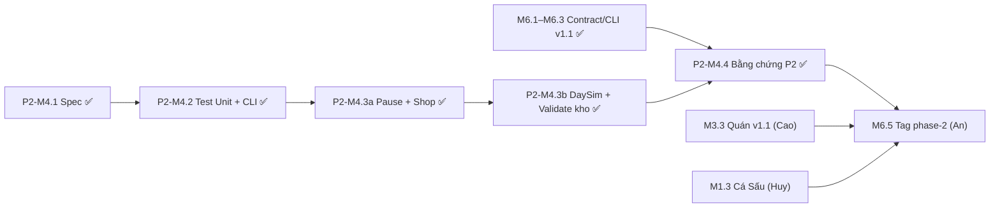
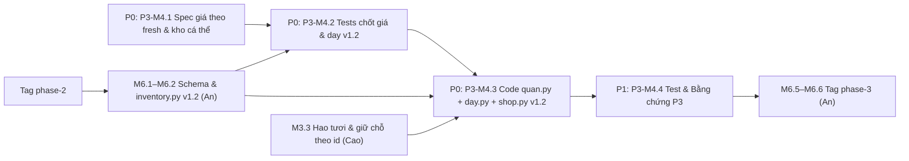
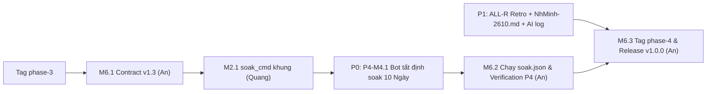

# Bảng theo dõi tiến độ toàn dự án — M4 (`NhMinh-2610`)

- **Phụ trách:** Nguyễn Nhật Minh (`NhMinh-2610`) · **Module:** M4 (Dev · dự phòng & review chéo M3 `ththanh8888`)
- **Nhánh làm việc:** `NguyenNhatMinh` (đã merge vào `main` qua PR #1 & PR #3, đồng bộ `main` tại `ba55889`)

---

## 1. Tổng quan 4 Phase

| Phase | Khung giờ | Hạn tag | Việc của M4 | Tiến độ | Trạng thái hiện tại |
|---|---|---|---|---|---|
| **Phase 1** | 0:00–1:00 | `phase-1` | `sim/quan` (bếp, bàn, bưng, tiền, tip, uy tín, hết ca) + ghép M3 | **100%** | ✅ Đã gắn tag `phase-1` |
| **Phase 2** | 1:00–1:55 | `phase-2` | `day`, `Shop`, `Pause` 3 mode *(+ tùy chọn `burn`)* | **95%** | ✅ Xong `P2-M4.1`–`P2-M4.4` (CLI + unit + bằng chứng); chỉ chờ `M3.3` & `M1.3` kiểm chung |
| **Phase 3** | 1:55–2:30 | `phase-3` | Độ tươi v1.2: giá `floor(giá × avg_fresh/100)`, `cook_started.items` cá thể, kho cá thể trong `day`/Shop *(+ tùy chọn `reservations`)* | **0%** | ⏳ Chờ tag `phase-2` |
| **Phase 4** | 2:30–3:00 | `phase-4` + `v1.0.0` | Bot tất định cho `soak_cmd` 10 Ngày (cùng Quang M2), Retro & chốt báo cáo *(+ tùy chọn `leaderboard`)* | **0%** | ⏳ Chờ tag `phase-3` |

---

## 2. Cần hỏi / phối hợp ai ngay bây giờ?

| Hỏi ai | Nội dung cần hỏi / chốt | Để mở khóa task nào của M4 |
|---|---|---|
| **An (`K0heii` — M6)** | Đã có bằng chứng `docs/proof/phase-2/m4-test-log.txt` (26/26 tests xanh) + CLI `--mode day` chạy xanh, nhờ An cập nhật vào `docs/verification/phase-2.md` ở `M6.5`. | Chốt `M6.5` & gắn tag `phase-2` |
| **Cao (`ththanh8888` — M3)** | 1. Khi nào đẩy `M3.3` (cập nhật 4 test P1 theo 4 bàn v1.1 + kiểm `day_plan`)? 2. Có làm chung mở rộng `burn` (Cháy món) trước 1:35 không? | Xanh 100% toàn bộ regression M3+M4 · Chốt mở rộng `burn` |
| **Thanh (`thanhvu101` — M5)** | Schema `Shop`/`Pause`/`day` đã chạy thật qua `chonoi.headless --mode day`, Thanh kiểm tra khớp UI `M5.3` nhé. | Khớp UI Shop/Pause ở cuối Phase 2 |

---

## 3. PHASE 1 — `sim/quan` (`0:00–1:00 · v1.0`) ✅ ĐÃ XONG

- [x] **M4.1** — Chốt Spec & 8 AC (`AC-M4-01` → `AC-M4-08`).
- [x] **M4.2** — Viết bộ test `tests/test_quan_m4.py` (12 test hộp đen & unit).
- [x] **M4.3** — Cài đặt bếp, bàn, bưng, tiền, tip, uy tín, hủy món mồ côi, hết ca trong `chonoi/sim/quan.py`.
- [x] **M4.4** — Ghép `CustomerMixin` của M3 (`quan_customers.py`), chạy xanh toàn bộ test + lưu bằng chứng `docs/proof/phase-1/m4-test-log.txt`.
- [x] **Quy trình P1** — Đủ ≥ 3 commit (`NhMinh-2610`), merge `main` (PR #1 & #3), điền `docs/standup.md`, `docs/ai-usage-log.md`, `docs/members/NhMinh-2610.md`, `tools/check_team.py` xanh.
- [x] **Chốt cuối P1:** Review chéo với Cao (`ththanh8888`), An (`K0heii`) đã chốt `verification/phase-1.md` và gắn tag `phase-1`.

---

## 4. PHASE 2 — `day`, `Shop`, `Pause` (`1:00–1:55 · v1.1`) ✅ XONG PHẦN M4

### Sơ đồ phụ thuộc gọn

### Đã hoàn thành (26/26 test M4 + CLI hộp đen v1.1 xanh)
- [x] **P2-M4.1** — Chốt Spec & `AC-P2-M4-01` → `AC-P2-M4-09` tại `docs/plan/spec-p2-m4.md`.
- [x] **P2-M4.2** — Viết `tests/test_day_shop_pause_m4.py` (6 unit test + 4 CLI black-box test trên `game.contract.json` v1.1: `--mode day --days 1|2`, Pause 3 mode, tất định từng byte, mã thoát `2` khi kho thực mâu thuẫn).
- [x] **P2-M4.3a** — Cài Pause (`paused`/`resumed`, `state:"paused"`) trong `chonoi/runner.py` và `ShopSim` trong `chonoi/sim/shop.py`.
- [x] **P2-M4.3b** — Cài `DaySim` trong `chonoi/sim/day.py` (`day_start → day_plan → gather → quan → shop → ngày kế`, kho trong bộ nhớ, lọc `day_plan`, kiểm `validate_quan_stock` lúc mở quán, áp `active_upgrades` từ Ngày kế).
- [x] **Regression P1** — Cập nhật tọa độ test ngoài mép ở `test_ac_m4_01` (`[3.51, 8]` → `[0.49, 8]`) do v1.1 thêm bếp `B2 [5, 8]`.
- [x] **P2-M4.4 (bằng chứng & log)** — Lưu bằng chứng `docs/proof/phase-2/m4-test-log.txt`, cập nhật `docs/standup.md` và `docs/ai-usage-log.md`.

### Việc còn lại (chờ đồng đội / tùy chọn)
- [ ] Kiểm chung với **Cao (`M3.3`)** & **Huy (`M1.3`)** khi hai nhánh merge vào `main`.
- [ ] Tham gia **retro nhanh 5 phút** (`docs/retro.md`) cuối Phase 2 (~1:45–1:50) & cập nhật `docs/members/NhMinh-2610.md`.
- [ ] *(Tùy chọn nếu muốn làm mở rộng)* **Mở rộng `burn`** (Cháy món `burn_s: 20`, `ready_ticks > 1200` → `dish_burnt`) cùng M3/M6.

---

## 5. PHASE 3 — Độ tươi & Kho cá thể (`1:55–2:30 · v1.2 — Mùa Nước Nổi`) ⏳ CHỜ TAG `phase-2`

> **Lưu ý Breaking Change (`phase-3-task.md` & `Ticket03.md`):** Đổi kho đếm sang kho cá thể `{"items":[{"id":"I1","kind":"...","fresh":100}]}` (v1.2 từ chối kho đếm mã `2`). Dùng chung đơn vị nguyên (`fresh_units = fresh × 240`, trừ 2/tick ở gather và 1/tick ở quán) để tránh sai số float ở ngưỡng `30` và phép `floor`.

### Phụ thuộc Phase 3

- [ ] **P3-M4.1** *(P0 — không chờ ai)*: Chốt Spec/AC cho:
  - Tiêu đúng `id` cá thể đang giữ khi nấu; chốt `base_price = floor(giá × avg_fresh / 100)` (chính xác theo `fresh_units`).
  - Boa `floor(base_price × 0.2)` tính trên giá đã chốt; `cook_started.items` là mảng cá thể sắp theo `(kind, id)`.
  - Bàn giao kho cá thể `{id, kind, fresh}` trong `day` (`gather → quan → shop`, Shop không hao tươi).
- [ ] **P3-M4.2** *(P0 — chờ `P3-M4.1`, `M6.1`)*: Viết test chốt `base_price` theo `avg_fresh`, boa trên giá đã chốt, `cook_started.items` sắp `(kind, id)`, bàn giao kho cá thể trong `day`.
- [ ] **P3-M4.3** *(P0 — chờ `P3-M4.2`, `M6.2`, `M3.3`)*: Code `chonoi/sim/quan.py`, `chonoi/sim/day.py`, `chonoi/sim/shop.py` cho kho cá thể v1.2 (giữ adapter tương thích trong lúc chuyển cho tới `M6.4`).
- [ ] **P3-M4.4** *(P1 — trước 2:20)*: Chạy test ngưỡng `fresh = 30`, chốt giá theo `avg_fresh`, kiểm `day`; lưu bằng chứng vào `docs/proof/phase-3/`; review chéo C ↔ D; cập nhật `docs/standup.md`, `docs/ai-usage-log.md`, `docs/members/NhMinh-2610.md`.
- [ ] *(Tùy chọn nếu lõi v1.2 xanh sớm)* **Mở rộng `reservations`** (Khách đặt trước `R1, R2` mỗi Ngày, giá `×1.5`, lỡ đơn uy tín `-1`) cùng Cao (`M3`).

---

## 6. PHASE 4 — Soak, Đóng gói & Phát hành `v1.0.0` (`2:30–3:00 · v1.3`) ⏳ CHỜ TAG `phase-3`

> **Lưu ý (`phase-4-task.md` & `Ticket04.md`):** Gameplay/tuning/kho/JSONL giữ nguyên theo `v1.2`; Phase 4 nâng `contract_version: "1.3"` và thêm `bench_cmd` + `soak_cmd`.

### Phụ thuộc Phase 4

- [ ] **P4-M4.1** *(P0 — chờ `M2.1` Quang)*: Hỗ trợ Quang hoàn thiện script bot tất định cho `soak_cmd --seed 7 --days 10 --out soak.json`:
  - Chạy 10 Ngày liên tục trong 1 tiến trình headless (D1–D5 lặp cho D6–D10, tiền/earned/uy tín/cấp/id cá thể xuyên suốt).
  - Test kỹ chuyển tiếp Ngày 5 → Ngày 6, đảm bảo `days_completed == 10`, `crashes == 0`, chạy lại cho kết quả gameplay giống hệt.
- [ ] *(Tùy chọn nếu nhóm cần đủ 2 Mở rộng)* **Mở rộng `leaderboard`**: lưu top 10 lượt chuẩn 5 Ngày cục bộ, `<run_cmd> --export-leaderboard`, cờ `--leaderboard` + `--player-name` trong `day` (thiếu 1 cờ hoặc sai mode → mã `2`), không đổi JSONL, `soak` không ghi xếp hạng.
- [ ] **ALL-R** *(P1 — 2:45–2:55)*: Tham gia Retro tổng kết 5 phút (`docs/retro.md`), chốt phản tư cá nhân `docs/members/NhMinh-2610.md` (≤ 200 từ, dẫn đủ commit), cập nhật `docs/ai-usage-log.md` trước **2:55** để An gắn tag `phase-4` & công bố Release `v1.0.0` trước **3:00**.
