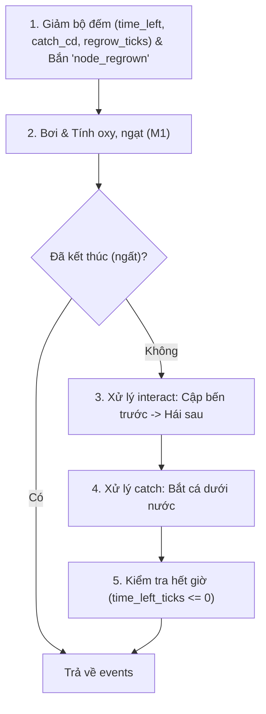

# Spec Kỹ Thuật: Module M2 (Thu hoạch + Kho `gather`) — Phase 1

- **Module:** M2 — Thu hoạch, Bắt cá, Giỏ LIFO, Cập bến & File Kho
- **Thành viên phụ trách:** Nguyễn Minh Quang (`QuangNEU`)
- **Vai quy trình:** Dev (Phối hợp với M1 — Vũ Quang Huy, M6 — Nguyễn Như Duy An)
- **Tài liệu căn cứ:** [PRD-0](../../PRD0.md) (mục E, F, G), [Hợp đồng Test Contract v1.0](../contracts/README.md), [game.contract.json](../../game.contract.json)

---

## A. Dev Spec

### 1. Tham số contract sử dụng (`game.contract.json["tuning"]["gather"]`)

| Key (`self.t["..."]`) | Giá trị | Đơn vị / Kiểu | Ý nghĩa trong logic M2 |
|---|---|---|---|
| `dock_pos` | `[2, 0]` | `[float, float]` | Tọa độ tâm cầu bến trên mặt phẳng `[x, d]` |
| `dock_radius` | `3` | `float` (mét) | Bán kính cập bến Euclid |
| `surface_depth` | `0.5` | `float` (mét) | Ngưỡng ranh giới mặt nước (`d <= 0.5` là mặt nước, `d > 0.5` là dưới nước) |
| `hold_capacity` | `12` | `int` (mục) | Sức chứa tối đa của giỏ đựng LIFO |
| `interact_radius` | `2.0` | `float` (mét) | Bán kính tương tác hái cây Euclid |
| `node_yield` | `1` | `int` (mục) | Số lượng nguyên liệu thu hoạch từ 1 nút cây |
| `regrow_s` | `20` | `float` (giây) | Thời gian cây mọc lại sau khi hái (quy đổi $20 \times 60 = 1200$ ticks) |
| `catch_radius` | `2.0` | `float` (mét) | Bán kính bắt cá Euclid |
| `catch_cooldown_s` | `0.5` | `float` (giây) | Thời gian hồi chiêu bắt cá (quy đổi $0.5 \times 60 = 30$ ticks) |
| `fish_yield` | `{"ca_linh": 3, "ca_loc": 1}` | `dict[str, int]` | Sản lượng thu được khi bắt từng đàn cá tương ứng |
| `nodes` | 4 nút (`N1`..`N4`) | `list[dict]` | Danh sách nút tài nguyên mặc định |
| `fish_initial` | 6 đàn (`F1`..`F6`) | `list[dict]` | Danh sách đàn cá mặc định ban đầu |

> **Quy tắc bất biến:** Tuyệt đối không hardcode bất kỳ con số nào trong logic code `gather.py`. Mọi hằng số đều truy xuất qua `self.t[...]` và quy đổi với hằng số `TICK = 60.0`.

---

### 2. Logic `step(self, inp)` — Theo thứ tự xử lý của tick

Quy trình xử lý một tick trong `GatherSim.step()` được thực hiện theo thứ tự nghiêm ngặt sau:

#### Chi tiết Bước 1: Giảm đếm ngược & Mọc lại nút (`node_regrown`)
1. Giảm `catch_cd_ticks = max(0, self.catch_cd_ticks - 1)`.
2. Duyệt qua các nút theo thứ tự sắp xếp ID (`sort_by_id(self.nodes)`):
   - Nếu `node["regrow_ticks"] > 0`: giảm 1 tick.
   - Nếu `node["regrow_ticks"] == 0` (vừa chạm 0 từ 1): bắn event `("node_regrown", {"node_id": node["id"]})`. Nút chuyển sang trạng thái `ready` và có thể hái ngay trong tick này nếu có lệnh.

#### Chi tiết Bước 3: Xử lý `interact` (Cập bến xét trước, Hái xét sau)
Nếu `inp.pressed("interact")` (cạnh lên từ `false` sang `true`):
1. **Xét cập bến trước:**
   - Điều kiện trong bến: $\text{dist}(\text{pos}, \text{dock\_pos}) \le \text{dock\_radius}$.
   - Nếu trong bến: kết thúc lượt ngay lập tức bằng `self._finish("docked", events)` và dừng bước.
2. **Nếu ngoài bến — xét Hái:**
   - **Điều kiện vùng:** Chỉ hái khi ở mặt nước (`self._at_surface()`, tức $\text{pos}[1] \le \text{surface\_depth}$). Nếu đang dưới nước, bỏ qua không hái.
   - **Tìm ứng viên:** Lọc danh sách các nút thỏa mãn đồng thời:
     - Đang sẵn sàng: `node["regrow_ticks"] == 0` (tức `ready == True`).
     - Trong tầm với: $\text{dist}(\text{pos}, \text{node["pos"]}) \le \text{interact\_radius}$.
   - **Chọn nút:**
     - Nếu không có nút nào: bỏ qua, không phát sinh sự kiện.
     - Nếu có $\ge 1$ nút: chọn nút có khoảng cách Euclid nhỏ nhất.
     - **Giải quyết hòa khoảng cách:** Nếu có nhiều nút cùng khoảng cách gần nhất, chọn nút có ID nhỏ nhất theo thứ tự `sort_by_id` (so sánh tiền tố và hậu tố số).
   - **Kiểm tra giỏ:**
     - Lấy sản lượng: $\text{yield} = \text{self.t["node\_yield"]}$ (mặc định 1).
     - Nếu $\text{len}(\text{self.hold}) + \text{yield} \le \text{self.t["hold\_capacity"]}$:
       - Thêm `yield` phần tử `node["kind"]` vào cuối `self.hold` (theo nguyên tắc LIFO).
       - Đặt thời gian mọc lại: `node["regrow_ticks"] = int(round(self.t["regrow_s"] * TICK))`.
       - Bắn event `("gather", {"node_id": node["id"], "kind": node["kind"], "amount": yield})`.
     - Nếu thiếu chỗ ($\text{len}(\text{self.hold}) + \text{yield} > \text{self.t["hold\_capacity"]}$):
       - Bắn event `("hold_full", {"action": "gather", "node_id": node["id"], "required": yield, "free": self.t["hold_capacity"] - len(self.hold)})`.
       - Nút giữ nguyên trạng thái `ready` (không đổi `regrow_ticks`).

#### Chi tiết Bước 4: Xử lý `catch` (Bắt đàn cá)
Nếu `inp.pressed("catch")` (cạnh lên từ `false` sang `true`):
1. **Điều kiện tiên quyết:**
   - Phải hết hồi chiêu: `self.catch_cd_ticks == 0`.
   - Phải ở dưới nước: `not self._at_surface()` (tức $\text{pos}[1] > \text{surface\_depth}$).
   - *(Nếu còn hồi chiêu hoặc đang ở mặt nước: bỏ qua hoàn toàn, không xét đàn cá, không kích hoạt cooldown).*
2. **Tìm ứng viên đàn cá:**
   - Lọc danh sách đàn cá trong `self.fish` thỏa mãn: $\text{dist}(\text{pos}, \text{fish["pos"]}) \le \text{catch\_radius}$.
3. **Chọn đàn cá:**
   - Nếu không có đàn nào trong tầm: bỏ qua không làm gì (không bắn sự kiện, không hồi chiêu).
   - Nếu có $\ge 1$ đàn: chọn đàn có khoảng cách Euclid nhỏ nhất.
   - **Giải quyết hòa khoảng cách:** Nếu có nhiều đàn cùng khoảng cách, chọn đàn có ID nhỏ nhất theo `sort_by_id`.
4. **Kiểm tra sức chứa & Xử lý bắt:**
   - Lấy sản lượng của loài: $\text{yield} = \text{self.t["fish\_yield"].get(fish["kind"], 1)}$ (`ca_linh`: 3, `ca_loc`: 1).
   - Nếu đủ chỗ ($\text{len}(\text{self.hold}) + \text{yield} \le \text{self.t["hold\_capacity"]}$):
     - Thêm `yield` phần tử `fish["kind"]` vào cuối `self.hold`.
     - Xóa đàn cá được chọn khỏi danh sách `self.fish`.
     - Kích hoạt hồi chiêu: `self.catch_cd_ticks = int(round(self.t["catch_cooldown_s"] * TICK))` ($0.5 \times 60 = 30$ ticks).
     - Bắn event `("fish_caught", {"fish_id": fish["id"], "kind": fish["kind"], "yield": yield})`.
   - Nếu thiếu chỗ ($\text{len}(\text{self.hold}) + \text{yield} > \text{self.t["hold\_capacity"]}$):
     - Bắn event `("hold_full", {"action": "catch", "fish_id": fish["id"], "required": yield, "free": self.t["hold_capacity"] - len(self.hold)})`.
     - Đàn cá giữ nguyên vị trí trong `self.fish`.
     - `self.catch_cd_ticks` giữ nguyên (không bị cooldown), không thử đàn cá khác.

#### Chi tiết Bước 5: Hết giờ & Kết thúc (`gather_end`)
1. Nếu `self.time_left_ticks <= 0`:
   - Kết thúc lượt: `self._finish("time", events)`.
2. Cơ chế xuất kho trong `self._finish(reason, events)`:
   - Đặt `self.done = True`, `self.reason = reason`.
   - Lấy kho: nếu `reason == "fainted"` thì kho là `{"items": {}}` (đã dọn sạch giỏ ở M1). Nếu `reason in ("docked", "time")` thì kho được tính qua `hold_to_items(self.hold)`.
   - Bắn event `("gather_end", {"reason": reason, "inventory": {"items": self.inventory_items()}})`.

---

### 3. Công thức tính & Cấu trúc dữ liệu

1. **Khoảng cách Euclid 2D:**
   $$\text{dist}(p_1, p_2) = \sqrt{(x_1 - x_2)^2 + (d_1 - d_2)^2}$$
   Tính chính xác trên số thực dấu phẩy động trước khi so sánh với bán kính (kể cả đúng mép bán kính $\le$).
2. **Cấu trúc giỏ hàng LIFO (`hold`):**
   - Mảng các chuỗi nguyên liệu: `["ca_loc", "bong_sung", ...]`.
   - Thêm vào: `self.hold.extend([kind] * yield_amount)`.
   - Khi ngất (`faint` do M1 gọi): `lost = list(reversed(self.hold))`, sau đó `self.hold.clear()`.
3. **Quy đổi giỏ sang kho (`hold_to_items`):**
   - Đếm tần suất các item trong `self.hold`.
   - Loại bỏ các item có số lượng $\le 0$.
   - Sắp xếp key tăng dần theo mã Unicode (`"bong_dien_dien"`, `"bong_sung"`, `"ca_linh"`, `"ca_loc"`).
   - Trả về object dict: `{"items": {...}}`.

---

### 4. Danh sách sự kiện bắn ra (`events`)

| Event Name | Điều kiện bắn | Payload (`data`) chuẩn contract |
|---|---|---|
| `node_regrown` | Đầu tick, `regrow_ticks` của nút vừa từ 1 về 0 | `{"node_id": str}` |
| `gather` | Nhấn `interact` ở mặt nước, trúng nút `ready`, giỏ đủ chỗ | `{"node_id": str, "kind": str, "amount": int}` |
| `fish_caught` | Nhấn `catch` dưới nước, hết hồi chiêu, trúng đàn cá, giỏ đủ chỗ | `{"fish_id": str, "kind": str, "yield": int}` |
| `hold_full` | Nhấn `interact` hoặc `catch` nhưng giỏ không đủ chỗ chứa toàn bộ `yield` | `{"action": "gather"\|"catch", ("node_id"\|"fish_id"): str, "required": int, "free": int}` |
| `gather_end` | Cập bến (`docked`), hết giờ (`time`), hoặc ngất (`fainted`) | `{"reason": "docked"\|"time"\|"fainted", "inventory": {"items": dict}}` |

---

### 5. Quy tắc Deterministic & Quản lý thực thể
- Duyệt và so sánh danh sách nút, đàn cá luôn qua hàm `sort_by_id`.
- Khi xóa đàn cá: xóa đúng đối tượng `fish` đã chọn bằng ID hoặc instance trong `self.fish`.
- Không sử dụng module `random` toàn cục hoặc hàm lấy thời gian hệ thống.

---

## B. Test Spec (Ma trận AC)

| Mã AC | Tiêu chí kiểm thử | Kịch bản / Fixture đầu vào | Lệnh kiểm chứng & Trường đối soát | Kết quả mong đợi |
|---|---|---|---|---|
| **AC-M2-01** | **Hái nút mặt nước thành công** | Fixture: player tại `[12, 0]`, nút `N1` tại `[12, 0]`, `hold: []`. Input: `tick: 0, interact: true`. | `--mode gather --scenario ... --ticks 2`   Đối soát event tại tick 1. | - Event `gather` với `node_id: "N1", kind: "bong_dien_dien", amount: 1`. - `hold` có 1 phần tử `"bong_dien_dien"`. - `nodes[0].ready == False`, `regrow_ticks == 1199`. |
| **AC-M2-02** | **Nút mọc lại (`node_regrown`)** | Fixture: nút `N1` có `regrow_ticks: 2`. Player đứng yên. Chạy 3 ticks. | `--mode gather --scenario ... --ticks 3`   Đối soát event tại tick 2. | - Tick 2 bắn event `node_regrown` với `node_id: "N1"`. - Tick 2 `snapshot.nodes[0].ready == True`. |
| **AC-M2-03** | **Giỏ đầy khi hái (`hold_full`)** | Fixture: player tại `[12, 0]`, `hold` chứa 12 nguyên liệu (đầy trần 12). Nút `N1` ready. Input: `interact: true`. | `--mode gather --scenario ... --ticks 1`   Đối soát event tại tick 1. | - Event `hold_full` với `action: "gather", node_id: "N1", required: 1, free: 0`. - `hold` giữ nguyên 12 phần tử. - Nút `N1` vẫn `ready == True`, không bị đặt hồi chiêu. |
| **AC-M2-04** | **Ưu tiên cập bến trước hái** | Fixture: player tại `[2, 0]` (vừa trong `dock_radius: 3`, vừa đặt nút `N0` tại `[2.5, 0]`). Input: `interact: true`. | `--mode gather --scenario ... --ticks 1`   Đối soát event tại tick 1. | - Bắn `gather_end` với `reason: "docked"`. - Không bắn `gather` hay `hold_full` đối với nút `N0`. |
| **AC-M2-05** | **Không hái cây khi ở dưới nước** | Fixture: player tại `[12, 2.0]` (độ sâu $d = 2.0 > 0.5$). Nút `N1` tại `[12, 0]` (khoảng cách $2.0 \le \text{interact\_radius}$). Input: `interact: true`. | `--mode gather --scenario ... --ticks 1`   Đối soát event tại tick 1. | - Không phát sinh event `gather` hay `hold_full`. - Nút `N1` giữ nguyên trạng thái `ready`. |
| **AC-M2-06** | **Bắt đàn cá dưới nước thành công** | Fixture: player tại `[15, 5]`, đàn cá `F1` (`ca_linh`) tại `[15, 5]`. Input: `tick: 0, catch: true`. | `--mode gather --scenario ... --ticks 2`   Đối soát event tại tick 1. | - Event `fish_caught` với `fish_id: "F1", kind: "ca_linh", yield: 3`. - `hold` thêm 3 con `ca_linh`. - Đàn `F1` biến mất khỏi `snapshot.fish`. - `catch_cd_ticks == 30` (giảm còn 29 ở tick 2). |
| **AC-M2-07** | **Bắt cá thiếu chỗ (`hold_full`)** | Fixture: player tại `[15, 5]`, `hold` có 10 items (còn trống 2). Đàn `F1` (`ca_linh`, yield 3). Input: `catch: true`. | `--mode gather --scenario ... --ticks 1`   Đối soát event tại tick 1. | - Event `hold_full` với `action: "catch", fish_id: "F1", required: 3, free: 2`. - Đàn `F1` vẫn còn nguyên trong `fish`. - `catch_cd_ticks == 0` (không bị phạt hồi chiêu). |
| **AC-M2-08** | **Không bắt cá khi ở mặt nước hoặc đang cooldown** | Fixture 1: Player tại `[15, 0.4]` (`at_surface == True`), đàn `F1` tại `[15, 1.0]`. Input: `catch: true`. Fixture 2: Player dưới nước nhưng `catch_cd_ticks: 10`. | `--mode gather --scenario ... --ticks 1`   Đối soát event tick 1. | - Không bắn `fish_caught`, không bắn `hold_full`. - Đàn cá giữ nguyên. |
| **AC-M2-09** | **Hòa khoảng cách chọn ID nhỏ nhất** | Fixture: Player tại `[30, 0]`. Hai nút `N1` tại `[29, 0]` và `N2` tại `[31, 0]` (cùng cự ly 1.0 m). Input: `interact: true`. | `--mode gather --scenario ... --ticks 1`   Đối soát event tick 1. | - Bắn `gather` cho `node_id: "N1"` (vì `N1 < N2`). |
| **AC-M2-10** | **Xuất file kho đúng hợp đồng** | Fixture: Player cập bến với `hold: ["ca_loc", "ca_linh", "ca_linh"]`. Chạy headless với `--inventory-out kho.json`. | Đọc file `kho.json` sau khi chạy xong. | - Nội dung file: `{"items": {"ca_linh": 2, "ca_loc": 1}}`. - Các loại có số lượng 0 không xuất hiện. Sắp xếp key tăng dần. |
